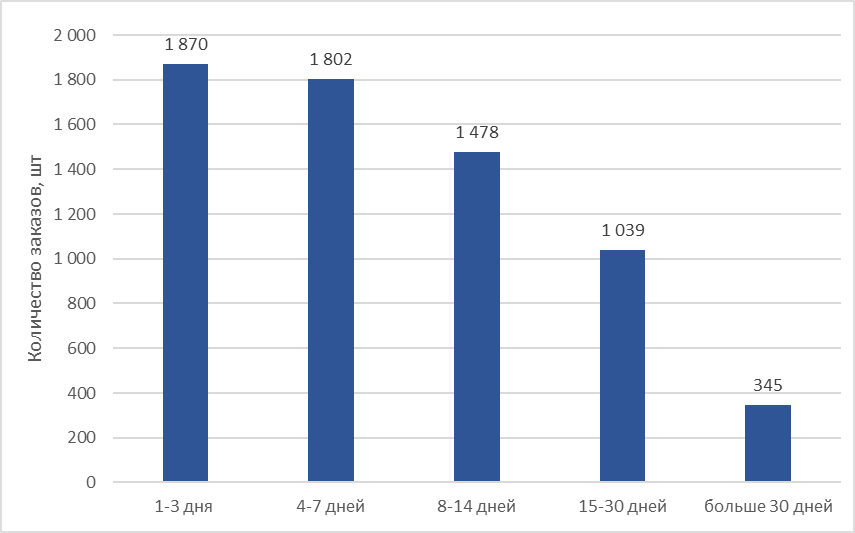
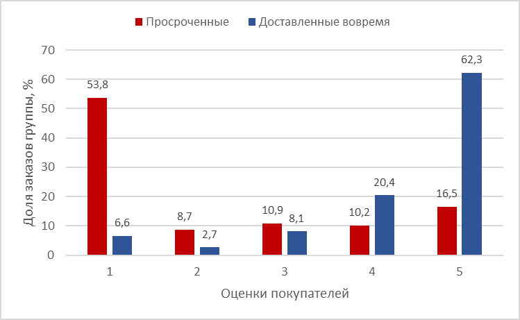
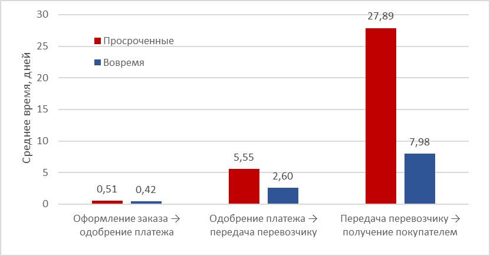

# Улучшение процесса доставки заказов в e-commerce (Olist)

Учебный аналитический проект (Business Analysis / Data Analysis) на открытых данных маркетплейса Olist.

| | |
|---|---|
| **Роль** | бизнес-аналитик |
| **Предметная область** | электронная коммерция, обработка и доставка заказов |
| **Данные** | [Brazilian E-Commerce Public Dataset by Olist](https://www.kaggle.com/datasets/olistbr/brazilian-ecommerce), 2016–2018 |
| **Инструменты** | PostgreSQL, DBeaver, Excel, Confluence, draw.io |

## Бизнес-проблема

Часть заказов доставляется позже обещанной даты, и это сильно влияет на оценки покупателей.

- Просрочено **6 534 из 96 470** доставленных заказов (**6,77%**).
- Типичная задержка около недели (медиана 7 дней, среднее 10,6 дня), у 10% просроченных заказов — больше 22 дней.
- Средняя оценка просроченных заказов **2,27**, доставленных вовремя — **4,29**.

## Цель

Предложить улучшения процесса доставки: контроль сроков, отслеживание статусов, выявление возможных задержек и своевременное информирование покупателей.

## Что сделано

1. **Анализ данных (SQL)** — доля и длительность просрочек, связь с оценками, время по этапам доставки, влияние географии. Запросы в [`sql/`](sql).
2. **Модели процесса AS-IS / TO-BE (BPMN)** — [AS-IS](images/bpmn_as_is.jpg), [TO-BE](images/bpmn_to_be.jpg).
3. **Требования** — бизнес-требования (MoSCoW), функциональные требования, риски.
4. **User Stories** с критериями приёмки.

Подробные отчёты по этапам:

- [Анализ данных](docs/01-data-analysis.md)
- [Моделирование процесса AS-IS / TO-BE](docs/02-process-modeling.md)
- [Требования, User Stories и риски](docs/03-requirements.md)

## Ключевые выводы

- Просрочки не массовые (6,77%), но у 21% из них задержка больше 14 дней.
- Просрочка сильно связана с низкими оценками: оценки 1–2 у 62,4% просроченных заказов против 9,3% у доставленных вовремя (это связь, а не доказанная причина).
- Основная потеря времени — этап «передача перевозчику → получение покупателем»: 27,89 дня у просроченных против 7,98 дня у доставленных вовремя. Этап «одобрение платежа → передача перевозчику» тоже длиннее (5,55 против 2,60 дня).
- Расстояние объясняет просрочки лишь частично: между штатами опаздывают чаще (8,0% против 4,5%), но и внутри каждого типа маршрута опоздавшие заказы едут в 3–4 раза дольше.

## Предлагаемое решение (TO-BE)

- Напоминание продавцу за день до крайнего срока передачи заказа и запрос причины, если спустя день после срока передача не подтверждена.
- Мониторинг статусов после передачи перевозчику, оценка риска срыва срока, запрос информации у перевозчика и уведомление покупателя об изменении прогнозируемой даты.

## Ограничения

- Данные за 2016–2018 годы, не отражают текущее состояние Olist.
- В датасете нет истории логистических событий, причины задержек на отдельных этапах установить нельзя.
- Штат — грубая оценка расстояния.
- TO-BE — концепция, эффективность не проверена на практике; целевые значения метрик — предварительные ориентиры.
