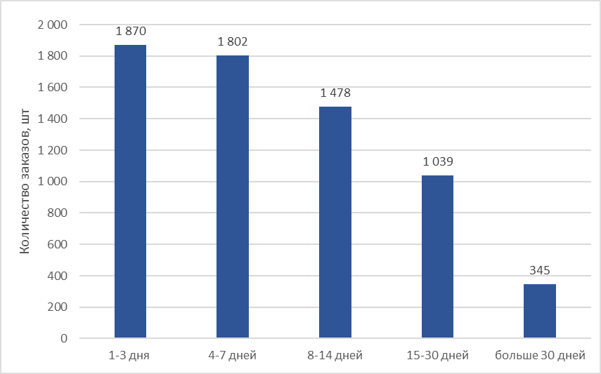
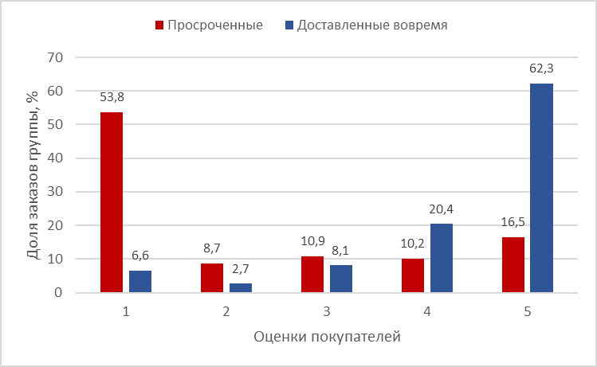
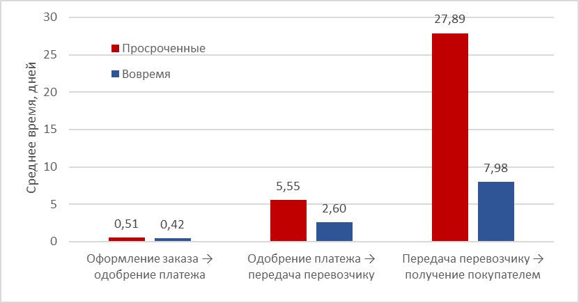

# Этап 1. Анализ данных о доставке заказов

## 1. Цель этапа

Подготовить данные Brazilian E-Commerce Public Dataset by Olist для анализа сроков доставки, определить долю просроченных заказов, оценить связь просрочек с оценками покупателей, выявить, на каких этапах доставки теряется время, и проверить влияние географии.

## 2. Источник данных

Использован публичный датасет Brazilian E-Commerce Public Dataset by Olist за 2016–2018 годы. Для анализа использованы таблицы `orders`, `order_reviews`, `order_items`, `customers`, `sellers`.

Инструменты: PostgreSQL, DBeaver, Excel.

| Таблица | Назначение | Ключевые поля |
|---|---|---|
| orders | Статусы заказов, даты оформления, одобрения платежа, передачи и получения, обещанная дата доставки | order_id, customer_id, order_status, order_purchase_timestamp, order_approved_at, order_delivered_carrier_date, order_delivered_customer_date, order_estimated_delivery_date |
| order_items | Связь заказов с продавцами и товарами, срок передачи заказа перевозчику, установленный для продавца | order_id, seller_id, shipping_limit_date |
| order_reviews | Оценки и комментарии покупателей | review_id, order_id, review_score |
| customers | География покупателей | customer_id, customer_state |
| sellers | География продавцов | seller_id, seller_state |

## 3. Подготовка данных

- Проверено количество записей и уникальных заказов.
- Проверены статусы заказов и заполненность дат. Пустые строки в полях с датами учтены отдельно от NULL.
- Для расчётов создано представление `orders_new` с приведением дат к типу timestamp.
- Для анализа просрочек отобраны доставленные заказы с заполненными фактической и ожидаемой датами получения.
- Для анализа отзывов заказы объединены с таблицей `order_reviews` по `order_id`, для каждого заказа учтён один отзыв.
- Для анализа географии заказы объединены с таблицами `customers` и `sellers` (через `order_items`); для заказов с несколькими продавцами учтён один продавец.

В исходной таблице `orders` содержалось 99 441 заказ. Для основного анализа просрочек использовано 96 470 доставленных заказов с необходимыми датами.

## 4. Проведённый анализ

### 4.1. Анализ заказов и сроков доставки

Рассчитаны количество и доля просроченных заказов, средняя, медианная и максимальная задержка, 90-й перцентиль, а также распределение по количеству дней. Просроченным считался заказ, доставленный позже обещанной даты; задержка в днях (`del_days`) рассчитана как дата доставки минус обещанная дата.

SQL-запросы: [`01_late_orders_summary.sql`](../sql/01-анализ временных интервалов.sql)

**Основные результаты:**

- Просрочено 6 534 заказа из 96 470 доставленных (6,77%).
- Типичная задержка составляет около недели: медиана 7 дней, среднее 10,6 дня.
- У 10% просроченных заказов задержка превышает 22 дня.
- Максимальная задержка составила 188 дней.

Больше половины просрочек (56,2%) укладываются в неделю, но каждая пятая (21,2%) превышает 14 дней.

### 4.2. Анализ отзывов покупателей

Проведено сравнение оценок покупателей для просроченных и доставленных вовремя заказов. В анализ вошли доставленные заказы, у которых есть отзыв (95 824 заказа). Если у заказа было несколько отзывов, учитывался только последний.

SQL-запрос: [`03_reviews_late_vs_on_time.sql`](../sql/03_reviews_late_vs_on_time.sql).

**Основные результаты:**

| Показатель | Просроченные | Доставленные вовремя |
|---|---|---|
| Количество заказов с отзывом | 6 381 | 89 443 |
| Средняя оценка | 2,27 | 4,29 |
| Оценки 1–2 | 3 983 | 8 289 |
| Доля оценок 1–2 | 62,42% | 9,27% |

Просроченные заказы получают заметно более низкие оценки: средняя оценка ниже на 2 балла (2,27 против 4,29), а доля оценок 1–2 выше примерно в 6,7 раза (62,4% против 9,3%).

Между просрочкой и низкой оценкой прослеживается выраженная связь, однако это не означает, что задержка является единственной причиной низкой оценки.

### 4.3. Анализ временных этапов доставки

Сравнена продолжительность трёх этапов для просроченных и доставленных вовремя заказов:

1. оформление заказа → одобрение платежа;
2. одобрение платежа → передача перевозчику;
3. передача перевозчику → получение покупателем.

В анализ вошли 96 455 заказов, 15 заказов из 96 470 исключены из-за отсутствия даты одобрения платежа или передачи перевозчику.

SQL-запрос: [`04_stage_durations.sql`](../sql/04_stage_durations.sql). Этап 2 считается как `o.carrier - o.approved`, этап 3 — как `o.delivered - o.carrier`.

**Основные результаты (среднее | медиана, дни):**

| Этап | Просроченные | Доставленные вовремя |
|---|---|---|
| Оформление заказа → одобрение платежа | 0,51 \| 0,02 | 0,42 \| 0,01 |
| Одобрение платежа → передача перевозчику | 5,55 \| 3,05 | 2,60 \| 1,76 |
| Передача перевозчику → получение покупателем | 27,89 \| 26,20 | 7,98 \| 6,94 |

- Оформление заказа и одобрение платежа занимают у обеих групп меньше суток: медиана составляет 0,01–0,02 дня (около 15–30 минут), различия между группами несущественны.
- Этап «одобрение платежа → передача перевозчику» у просроченных заказов в среднем в 2,1 раза длиннее (5,55 против 2,60 дня). По медиане разница меньше (3,05 против 1,76 дня, в 1,7 раза), значит, на этом этапе проблема проявляется не у всех заказов, а у их части.
- Основная разница приходится на этап «передача перевозчику → получение покупателем»: у просроченных заказов он длится в среднем 27,89 дня, у доставленных вовремя — 7,98 дня (по медиане 26,20 и 6,94 дня), то есть в 3,5–3,8 раза дольше. Близкие значения среднего и медианы показывают, что так обстоит дело у большинства просроченных заказов.

### 4.4. Анализ географии

Чтобы проверить, не объясняется ли длительность этапа «передача перевозчику → получение покупателем» только расстоянием, заказы разделены на два типа маршрута: продавец и покупатель в одном штате и в разных штатах.

В анализ вошли те же 96 455 доставленных заказов. Для заказа с несколькими продавцами выбирается продавец с минимальным id.

SQL-запрос: [`05_geography.sql`](../sql/05_geography.sql).

**Доля просроченных заказов:**

- один штат: 1 564 / (1 564 + 33 132) × 100% = 4,5%;
- разные штаты: 4 969 / (4 969 + 56 790) × 100% = 8,0%.

Заказы между штатами опаздывают чаще (8,0% против 4,5% внутри штата). Но и на коротких, и на длинных маршрутах опоздавшие заказы едут от перевозчика к покупателю в 3–4 раза дольше, чем доставленные вовремя. Значит, расстояние влияет на просрочки, но не объясняет их полностью.

Штат даёт лишь примерное представление о расстоянии. Обещанная дата доставки, вероятно, уже учитывает расстояние, поэтому просрочка означает опоздание относительно обещанного срока.

## 5. Основные выводы анализа

1. **Просрочки есть, но не массовые.** 6,77% заказов (6 534 из 96 470) доставлены позже обещанной даты. Типичная задержка около недели (медиана 7 дней), но у 10% она превышает 22 дня, а 345 заказов (5,28%) опоздали более чем на 30 дней.
2. **Просрочка связана с резким падением оценок.** Средняя оценка просроченных заказов 2,27 против 4,29 у доставленных вовремя, оценки 1–2 у 62,4% против 9,3%. Это связь, а не доказанная причина.
3. **Время теряется после передачи перевозчику.** Этап «передача перевозчику → получение покупателем» у просроченных заказов длится 27,89 дня против 7,98 дня (медиана 26,20 против 6,94). Этап передачи заказа перевозчику также длиннее (5,55 против 2,60 дня), причём, по-видимому, не у всех заказов. Оформление и одобрение платежа у групп не различаются.
4. **Расстояние не объясняет просрочки полностью.** Заказы между штатами опаздывают чаще (8,0% против 4,5%), но и внутри каждого типа маршрута опоздавшие заказы едут в 3–4 раза дольше доставленных вовремя.
5. **Ограничения.** Датасет не содержит истории логистических событий, поэтому причины задержек на этапе доставки установить нельзя. Штат — грубая оценка расстояния, а связь с оценками не означает причинность.
