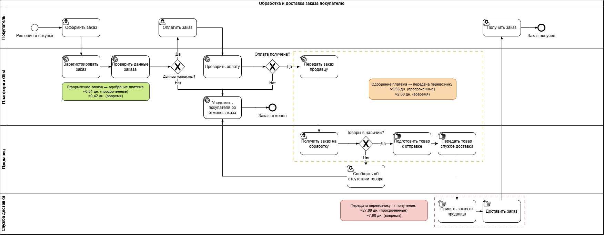
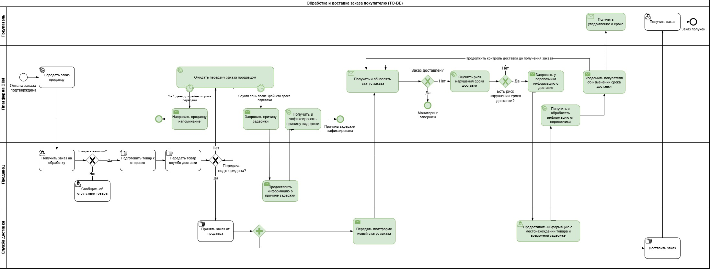

# Этап 2. Моделирование процесса: AS-IS и TO-BE

## 1. Цель этапа

Представить текущий процесс обработки и доставки заказов (AS-IS), выявить его проблемные места на основе проведённого анализа и предложить улучшенный вариант процесса (TO-BE).

## 2. Модель AS-IS

Модель AS-IS представляет собой аналитическую реконструкцию процесса обработки и доставки заказов. Она отражает предполагаемую последовательность основных этапов, восстановленную по доступным данным.

В процессе выделены следующие основные этапы:

1. Покупатель оформляет и оплачивает заказ.
2. Платформа Olist регистрирует заказ, проверяет данные и подтверждение оплаты.
3. После подтверждения оплаты заказ передаётся продавцу.
4. Продавец проверяет наличие товара, подготавливает его и передаёт службе доставки.
5. Служба доставки принимает и доставляет заказ покупателю.
6. Покупатель получает заказ.

Из трёх рассмотренных интервалов для дальнейшей проработки выбраны два, в которых выявлены наиболее заметные различия между заказами с задержкой и доставленными вовремя (среднее время в днях, просроченные и доставленные вовремя):

- одобрение платежа → передача перевозчику (5,55 и 2,60 дня);
- передача перевозчику → получение покупателем (27,89 и 7,98 дня).

Интервал от оформления заказа до одобрения платежа отдельно не рассматривался, поскольку существенной разницы между группами не выявлено.

**Схема AS-IS:**

## 3. Модель TO-BE

Модель TO-BE представляет усовершенствованный вариант процесса с дополнительными механизмами контроля на двух проблемных этапах: передаче заказа продавцом и доставке после передачи перевозчику.

Изменения помогут быстрее замечать, когда сроки могут сорваться, выяснять причины задержек и вовремя сообщать об этом покупателям.

### 3.1. Контроль передачи заказа продавцом

После передачи заказа продавцу платформа контролирует срок передачи товара службе доставки. Для предотвращения просрочек предусмотрены следующие механизмы:

- За день до крайнего срока платформа автоматически отправляет продавцу напоминание о необходимости передать заказ.
- Если через день после крайнего срока передача не подтверждена, платформа запрашивает у продавца причину задержки.
- Продавец указывает причину — платформа фиксирует эту информацию.
- После подтверждения передачи заказ принимает служба доставки, а платформа обновляет статус заказа.

При повторяющихся нарушениях сроков передачи заказов в дальнейшем можно предусмотреть дополнительные меры воздействия на продавцов, например предупреждения, временное ограничение приёма новых заказов или штрафные санкции. Конкретные условия применения таких мер требуют отдельного определения.

Собранные данные о причинах задержек позволяют анализировать проблемные места и при необходимости согласовывать с продавцом дальнейшие действия.

### 3.2. Мониторинг доставки после передачи перевозчику

После получения информации о передаче заказа перевозчику платформа начинает контролировать дальнейший процесс доставки до момента получения заказа покупателем.

1. Платформа получает и обновляет информацию о статусе заказа, поступающую от службы доставки.
2. Проверяется, доставлен ли заказ покупателю. Если да, мониторинг завершается.
3. Если заказ ещё не доставлен, система оценивает риск нарушения ожидаемого срока доставки. При оценке учитываются оставшееся время до ожидаемой даты доставки и актуальность информации о статусе заказа.
4. Если риск не выявлен, мониторинг продолжается: платформа ожидает последующих обновлений статуса заказа.
5. Если риск выявлен (например, срок приближается, а статус заказа долго не обновляется), платформа запрашивает у перевозчика информацию о местонахождении заказа и возможной задержке.
6. После получения ответа перевозчика платформа обрабатывает информацию, уточняет прогнозируемый срок доставки и уведомляет покупателя о возможном изменении даты получения заказа.
7. После уведомления покупателя мониторинг продолжается до фактического получения заказа.

Таким образом, предлагается дополнить процесс доставки механизмом контроля статусов и оценки риска нарушения срока. Это позволит не только отслеживать факт задержки, но и реагировать на признаки возможного нарушения срока до того, как покупатель столкнётся с несвоевременной доставкой.

**Схема TO-BE:**

### 3.3. Границы модели

Модель показывает основной сценарий и ключевые отклонения, выявленные в ходе анализа: позднюю передачу заказа продавцом и риск нарушения срока доставки. При этом приняты следующие допущения:

- Отмена заказа при отсутствии товара у продавца показана в модели AS-IS и в предлагаемых изменениях не затрагивается.
- Не рассматриваются возвраты, повторные отправки, утрата заказа и другие редкие сценарии.
- Обновления статусов службой доставки показаны на схеме обобщённо: предполагается, что перевозчик передаёт их по мере движения заказа. Оценка риска при длительном отсутствии обновлений описана в тексте и на схеме отдельно не отображена.
- Пороговые значения (за сколько дней отправлять напоминание, через какое время запрашивать информацию у перевозчика, при каких условиях риск считается выявленным) определяются на этапе детализации требований.
- Модель является концепцией улучшения и не учитывает изменения, которые могли быть уже внедрены в Olist.

## 4. Ожидаемый результат изменений

Цель предлагаемых изменений — сделать процесс доставки более управляемым и выстроить чёткое взаимодействие между платформой, продавцами, службой доставки и покупателями.

Контроль сроков передачи заказов поможет оперативно фиксировать случаи, когда продавец не успевает передать товар службе доставки в оговорённый срок, и сразу выяснять причины задержки.

После передачи заказа перевозчику система будет отслеживать статусы и выявлять риски срыва сроков. При необходимости платформа запросит у службы доставки дополнительные сведения. Покупатели при этом будут своевременно узнавать об изменении прогнозируемого срока доставки — это снизит их тревожность в ожидании заказа.

Реализация изменений позволит:

- сократить число заказов с опозданием;
- повысить прозрачность доставки для всех участников процесса;
- усилить контроль за тем, насколько своевременно продавцы передают заказы;
- быстрее находить и фиксировать проблемы на этапе доставки;
- уменьшить количество жалоб и обращений из-за задержек;
- укрепить доверие и повысить удовлетворённость клиентов.

Эффективность изменений можно будет оценивать по следующим метрикам: доля просроченных заказов (на момент анализа 6,77%), доля заказов, переданных продавцами в срок, своевременность обновления статусов доставки, а также доля покупателей, получивших уведомление о возможной задержке.
